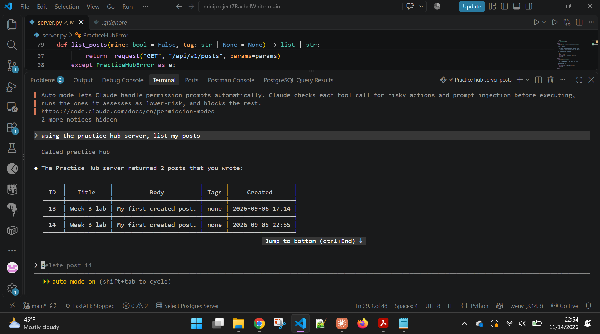
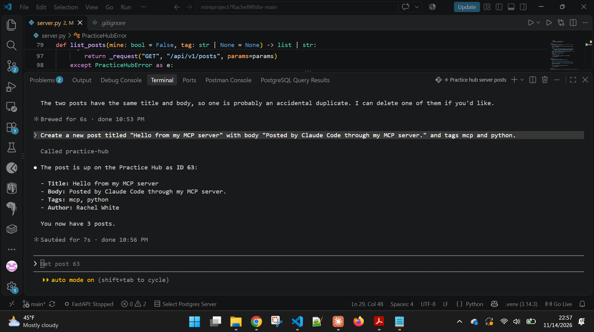
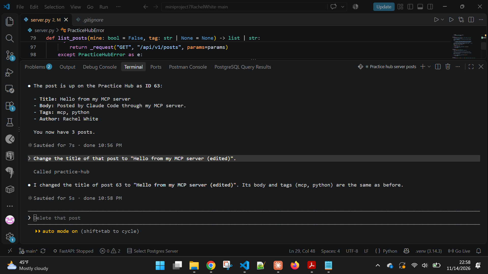

### INF601 - Advanced Programming in Python
### Rachel White
### Mini Project 7


# Practice Hub MCP Server

An MCP (Model Context Protocol) server that lets Claude Code read, create, edit, and delete your own
posts on the Practice Hub, using the same REST API as Mini Project 1.

## Description

`server.py` is a FastMCP server, built with the official `mcp` Python SDK, that wraps the Practice
Hub REST API at `https://practice.fhsucyber.com/api/v1`. It provides five tools, and each one calls
one API endpoint:

| Tool | API call | What it does |
|------|----------|--------------|
| `list_posts(mine=False, tag=None)` | `GET /api/v1/posts?mine=…&tag=…` | Lists posts. `mine=True` returns only your posts. `tag` filters by tag. |
| `get_post(post_id)` | `GET /api/v1/posts/{id}` | Gets one post by id. |
| `create_post(title, body="", tags=None)` | `POST /api/v1/posts` | Creates a new post as you. |
| `update_post(post_id, title=None, body=None, tags=None)` | `PATCH /api/v1/posts/{id}` | Edits one of your posts. Only the fields you pass are changed. |
| `delete_post(post_id)` | `DELETE /api/v1/posts/{id}` | Deletes one of your posts. |

Every tool has a docstring, which Claude reads to decide when to call it. Requests use `httpx` and
send `Authorization: Bearer <token>`. The API URL and token come from environment variables and are
never hard-coded. The server uses the default **stdio** transport. When the API returns an error, the
tool returns a clear message instead of crashing the server, so Claude can tell you what went wrong:

```
Error 403: Permission denied - you can only edit or delete your own posts. Server said: You can only modify your own posts.
Error 404: Not found - no post exists with that id. Server said: Post not found.
Error 401: Authentication failed - PRACTICE_API_TOKEN is missing, invalid, or expired.
```

Network failures, timeouts, and a missing token are handled the same way.

## Getting Started

### Dependencies

* Windows 10/11, macOS, or Linux
* Python 3.10 or newer
* [Claude Code](https://docs.claude.com/en/docs/claude-code) CLI (`npm install -g @anthropic-ai/claude-code`)
* A Practice Hub account and API token (the same one as Mini Project 1)
* Python packages, listed in `requirements.txt`:
    * `mcp[cli]>=1.9,<2` — the MCP SDK with FastMCP. It is pinned below 2 because version 2 renamed `FastMCP` to `MCPServer`.
    * `httpx` — the HTTP client
```
pip install -r requirements.txt
```

### Installing

* Clone the repository and create a virtual environment:
```
git clone https://github.com/rachelr801/miniproject7RachelWhite.git
cd miniproject7RachelWhite
python -m venv .venv
```
* Activate the virtual environment and install the dependencies:
```
# Windows PowerShell
.venv\Scripts\Activate.ps1

# macOS / Linux
source .venv/bin/activate

pip install -r requirements.txt
```
* Set your environment variables. **Never commit your token.** `.env` files are already in `.gitignore`.

| Variable | Required | Default |
|----------|----------|---------|
| `PRACTICE_API_TOKEN` | yes | none |
| `PRACTICE_API_URL` | no | `https://practice.fhsucyber.com` |

```
# Windows PowerShell
$env:PRACTICE_API_URL = "https://practice.fhsucyber.com"
$env:PRACTICE_API_TOKEN = "your-token-here"

# macOS / Linux
export PRACTICE_API_URL="https://practice.fhsucyber.com"
export PRACTICE_API_TOKEN="your-token-here"
```

### Executing program

* Register the server with Claude Code from the project folder. The `-e` flags pass your
  environment variables to the server, and the token is saved in your local Claude Code config
  (`~/.claude.json`), not in this repo. The general form is
  `claude mcp add practice-hub -- python server.py`. These commands use the venv's Python and full
  paths so the server starts with the right packages installed:
```
# Windows PowerShell
claude mcp add practice-hub -e PRACTICE_API_URL=$env:PRACTICE_API_URL -e PRACTICE_API_TOKEN=$env:PRACTICE_API_TOKEN -- "$PWD\.venv\Scripts\python.exe" "$PWD\server.py"

# macOS / Linux
claude mcp add practice-hub -e PRACTICE_API_URL="$PRACTICE_API_URL" -e PRACTICE_API_TOKEN="$PRACTICE_API_TOKEN" -- "$PWD/.venv/bin/python" "$PWD/server.py"
```
* Confirm it registered. You should see `practice-hub: ... - ✓ Connected`:
```
claude mcp list
```
* Start Claude Code in the project folder:
```
claude
```
* Run the **acceptance test** (read → create → modify through the server) by sending these
  prompts one at a time and approving each tool call:
    1. **Read:** `using the practice hub server, list my posts`
    2. **Create:** `Create a new post titled "Hello from my MCP server" with body "Posted by Claude Code through my MCP server." and tags mcp and python.`
    3. **Modify:** `Change the title of that post to "Hello from my MCP server (edited)".`

#### Acceptance test results

1. **Read:** Claude Code called `practice-hub` (`list_posts` with `mine=true`) and listed my 2 posts.

   

2. **Create:** Claude Code called `create_post`, and the new post was created as ID 63 with tags `mcp` and `python`.

   

3. **Modify:** Claude Code called `update_post`, and post 63's title changed to "Hello from my MCP server (edited)".

   

## Help

* **401 "Missing or invalid Authorization header"** — `PRACTICE_API_TOKEN` is not set for the
  server. Re-run `claude mcp add` with `-e PRACTICE_API_TOKEN=...`. If you lost your token, get a
  new one by POSTing your email and password to `/api/v1/auth/token`.
* **403** — you tried to edit or delete a post that isn't yours. The tool returns a
  permission-denied message.
* **404** — no post has that id. The tool returns a not-found message.
* **Claude Code can't see the server** — run `claude mcp list` and start `claude` from the project
  folder, because the server is registered for that folder. `server.py` never uses `print()`,
  since stdio uses stdout for the protocol.
* **`claude` is not recognized** — open a new terminal after installing the CLI.
* **`No module named 'mcp.server.fastmcp'`** — you have `mcp` 2.x installed. Run `pip install -r requirements.txt`.
* To check the server and its tools in Claude Code:
```
/mcp
```
* To test a tool without Claude Code:
```
python -c "import server; print(server.list_posts(mine=True))"
```

## Authors

Rachel White
[@rachelr801](https://github.com/rachelr801)

## Version History

* 0.2
    * Acceptance test screenshots
* 0.1
    * Initial Release: FastMCP server with five tools, requirements.txt, and README

## License

This project is coursework for INF601 and is not licensed for reuse.

## Acknowledgments

* [Model Context Protocol Python SDK](https://github.com/modelcontextprotocol/python-sdk)
* [Practice Hub API guide](https://practice.fhsucyber.com/docs-guide)
* [Claude Code MCP docs](https://docs.claude.com/en/docs/claude-code/mcp)
* [awesome-readme](https://github.com/matiassingers/awesome-readme)

## AI Usage

I reused the endpoint and error handling design from Mini Project 1 client and the tutorial at https://py.sdk.modelcontextprotocol.io/ as the start for this project. I also used Claude Code (Claude Opus 5.5) as an assistant on this project. I gave it the assignment and my Mini Project 1 client, and it helped me:

* test every tool against the live API, including the 403 and 404 cases,
* register the server with `claude mcp add`, and
* draft this README.

I reviewed and edited the code myself, ran the acceptance test through Claude Code, and checked the
results on the Practice Hub site.
